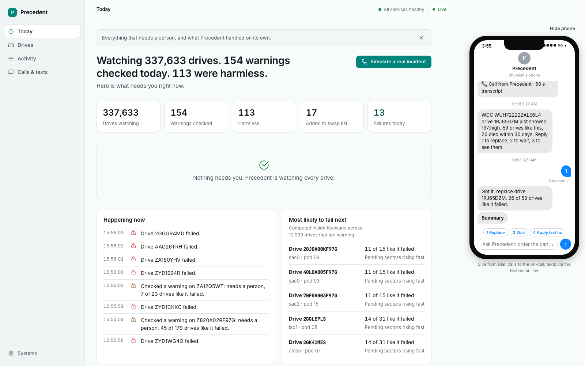
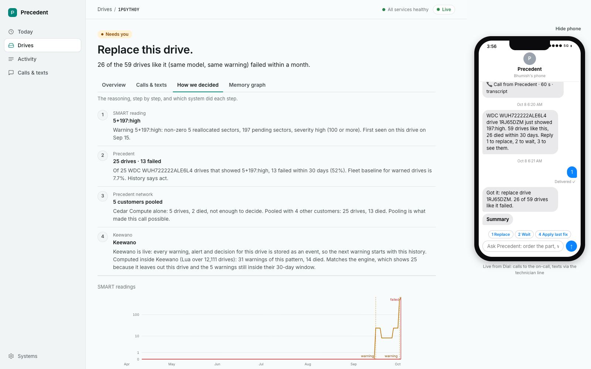

# Precedent

Precedent decides which disk warnings are worth waking someone up for. When a drive throws a SMART warning, it
looks up every identical drive (same model, same warning pattern) and counts how many failed within 30 days. It only
pages a person when that history says the drive is likely to die.



## Why

In six months of Backblaze's public drive data, 80% of the drives that failed showed a SMART warning first, and so
did 9% of the drives that kept working. Only 7.7% of warnings in the test window were followed by a failure, so teams
end up either checking every warning or ignoring them.

Precedent was tested on a time split: thresholds were learned from warnings whose outcome was known before
19 Apr 2026, then applied to the 4,427 warnings after it.

| | Checks a person does | Failures caught | Checks that were real |
|---|---|---|---|
| Check every warning | 4,427 | 342 | 7.7% |
| Urgent page (at least 15 identical drives, at least 25% died) | 43 | 20 | 47% |
| Morning swap list (at least 10 identical drives, at least 10% died) | 595 | 164 | 28% |

Definitions, calibration and the pooled-history comparison are in [NUMBERS.md](NUMBERS.md).

## How it works

1. A collector on each server reads SMART data with `smartctl` and posts it to `POST /v1/telemetry`.
2. The engine turns the reading into a pattern such as `197:high` and looks up every identical drive. Customers pool
   their history, so a small fleet still gets an answer backed by enough drives.
3. Harmless warnings are logged. Watch-level ones join the morning swap list.
4. Urgent ones open an incident and page the on-call engineer through Dial. They get a text, then a call a few seconds
   later that reads out the evidence and asks whether to swap the drive, wait, or apply the fix that worked last time.
5. The answer is logged as a decision, whether it came from the call, a text reply, a Slack button or the console. A
   repeat answer is acknowledged and ignored, and a page nobody answers escalates once.
6. A swap starts the follow-up work: a remote-hands ticket rehearsed in a Sparta sandbox first, and a Darwin search
   for the replacement part and the warranty return.

Every incident moves forward through one lifecycle: detected, triaged, paged, acknowledged, decided, actioned,
resolved, verified. Each step records who did it and on which channel, and the console receives it over SSE.



## Partners

**Dial** carries the human loop. It sends the text, places the voice call, and turns the transcript or the 1/2/3 text
reply into a decision. Replies arrive by long-polling Dial's event API, so no tunnel is needed. During a call, a small
MCP tool (`precedent/context_mcp.py`) lets the engineer ask which drives are like this one; it only answers for drives
that were alerted to the caller's phone.

**Keewano** stores every drive as an entity, with its warnings, failure and human decisions as events. The precedent
table and the at-risk ranking are computed inside Keewano by the Lua jobs in `keewano/`, so the data never leaves the
database to be scored.

**Sparta** is where a fix is rehearsed before it touches anything real. After a swap, Precedent opens one remote-hands
ticket in a Sparta world. Sparta can inject a failure on ticket creation, and the ticket step has to retry, recover
and still end with exactly one ticket. Creation is idempotent on the alert id.

**Darwin** finds agents that can act on the decision: locating a replacement part, getting a supplier quote or filing
a warranty return. Precedent only contacts an agent through a route Darwin publishes, and logs every attempt.

## Layout

| Path | What it holds |
|---|---|
| `precedent/server.py` | FastAPI app: alert, webhook, incident and console routes |
| `precedent/engine.py` | DuckDB engine: warning events, outcomes, counts per model and pattern, backtest |
| `precedent/public_api.py` | `/v1` REST API and the public MCP server |
| `precedent/lifecycle.py` | Incident state machine and the escalation timer |
| `precedent/decisions.py`, `db.py`, `events.py`, `actions.py` | Append-only logs, the SQLite operational DB, the SSE event bus, the action log |
| `precedent/dial.py`, `listener.py`, `context_mcp.py`, `tech.py` | Dial texts and calls, inbound long-poll, the in-call MCP tool, the technician inbox |
| `precedent/keewano.py`, `keewano/*.lua` | Keewano ingest and the in-database jobs |
| `precedent/sparta.py`, `darwin.py`, `playbooks.py` | What happens after a decision: the ticket, the agent search, fixes learned from past resolutions |
| `precedent/notify.py` | Slack, Discord, Teams and plain webhook notifications |
| `precedent/collector.py`, `fleet_replay.py`, `simteam.py` | Readings coming in: real disks, a day-by-day Backblaze replay, a labelled simulated team for replayed incidents |
| `precedent/ingest.py`, `locations.py` | Build the dataset from Backblaze's quarterly zips |
| `precedent/web/` | Console, landing and onboarding pages, and the console's read-only JSON |
| `scripts/` | Smoke test, browser end-to-end test, key preflight, dry-run rehearsal, demo launcher |
| `data/samples/` | Fixtures the app serves when the full dataset isn't built |

## Run it

```bash
uv venv --python 3.12 .venv
uv pip install --python .venv/bin/python -r requirements.txt
cp .env.example .env
.venv/bin/uvicorn precedent.server:app --port 8000
```

On Windows, use `.venv\Scripts\python.exe` and `.venv\Scripts\uvicorn.exe`.

With no keys in `.env`, Dial, Keewano, Darwin and Sparta run in dry-run and nothing leaves the machine. Open
http://localhost:8000 for the landing page and http://localhost:8000/app for the console, then press
**Simulate a real incident**.

Without `data/precedent.duckdb` the app serves the fixtures in `data/samples/`. To build the full dataset, put
Backblaze's Q1 and Q2 2026 drive stats zips in `data/raw/` and run:

```bash
python -m precedent.ingest data/raw/data_Q1_2026.zip data/raw/data_Q2_2026.zip
python -m precedent.engine
python -m precedent.locations data/raw/data_Q1_2026.zip data/raw/data_Q2_2026.zip
```

## Tests

```bash
.venv/bin/python scripts/smoke.py   # in-process, no keys, no network
.venv/bin/python scripts/e2e.py     # the full flow in a browser against the services in .env
```

`scripts/e2e.py` needs Playwright's browser: `python -m playwright install chromium`.

## API

Other sites and agents talk to Precedent over `/v1`:

| Route | Does |
|---|---|
| `POST /v1/telemetry` | Takes a drive's SMART counters, returns its pattern and precedent, and pages when history says act |
| `POST /v1/fleet/heartbeat` | One day of a fleet's readings: triages each warning and records failures |
| `GET /v1/precedent?model=&pattern=` | What happened to every drive like this one |
| `GET /v1/drives/{serial}` | One drive's history |
| `POST /v1/decisions` | Log a decision from another system |

Send the key as `X-Precedent-Key` or `Authorization: Bearer <key>`. The same four operations are available to agents
as MCP tools at `/mcp-public/`: `check_warning`, `report_telemetry`, `get_drive` and `log_decision`.

## Known limits

- The console and its `/api` routes have no login, and they return the on-call and technician phone numbers in
  full. Run it on a private network or behind your own auth.
- The `/v1` API and MCP are open until `PRECEDENT_API_KEYS` is set. Without keys, anyone who can reach it can also
  grow the per-serial caches in `public_api.py` by posting made-up serials.
- `POST /webhooks/dial` doesn't check a signature. The default inbound mode (`DIAL_INBOUND=poll`) doesn't need it.
- Backblaze counts drives pulled early as failures, so the history mixes "died" with "pulled". Logging every human
  decision is how Precedent learns the difference.
- SMART 187 is partly self-fulfilling, because Backblaze replaces drives once it is non-zero. Patterns with 187 are
  labelled circular and left out of the headline numbers.
- Carriers block SMS from unregistered US numbers, so the voice call is the main channel and texts are a backup.

Drive history comes from Backblaze's public drive stats. Precedent started at SpeedHacks 2026.
